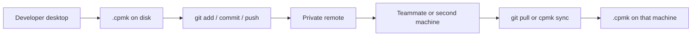

# CPMK user guide

This is the operator guide for CPMK 1.0 on a developer desktop and in Git. It is written for someone who wants to use the tool on a real project, not implement it.

The same pages are available in the local app:

```bash
npm run demo
```

Then open [http://127.0.0.1:7435/guide](http://127.0.0.1:7435/guide). From a packaged install, run `cpmk dashboard` in the project and use **Guide** and **Demo**.

## 1. What CPMK is

CPMK (Cursor Project Memory Kit) is a **local-first** memory store for a software project. You write down the things an AI session, a teammate, or tomorrow-you will otherwise lose:

- conventions (“API errors use RFC 9457”)
- decisions (“sessions are a tagged task, not a new schema field”)
- warnings (“never commit credentials”)
- current work (tasks and an open session)
- handoffs (“paused after the login form”)

Those notes live as versioned JSON under `.cpmk/` in the project. The CLI can assemble a **bounded Markdown context** for Cursor or any other tool. Nothing in the core product phones home, scrapes chat, or needs a database.

The source of truth is always the files on disk. The CLI, the loopback dashboard, and a future desktop window are adapters over the same files.

## 2. Mental model: desktop and Git

Think of two copies of the same project, not two products.

```text
  Your machine                         Git
  ------------                         ---
  ~/code/app                           origin/main
    src/                                 src/
    .cpmk/config.json                    .cpmk/config.json     ← commit
    .cpmk/memory/*.json                  .cpmk/memory/*.json   ← commit
    .cpmk/generated/                     (gitignored)          ← do not commit
    .cpmk/plugins/                       optional              ← commit if shared
```

**On the desktop**, CPMK is just a folder. `cpmk remember` writes one JSON file. `cpmk context` reads those files and prints Markdown. `cpmk dashboard` opens a browser UI on `127.0.0.1` that calls the same functions. If you never run Git, the tool still works.

**In Git**, memory is ordinary project content. A teammate who pulls the branch gets the same conventions and decisions. A second laptop that clones the repo gets the same store. CPMK does not push, pull, or open a network socket for sync. You use Git (or `cpmk sync` against a path or a Git ref) the way you already move source.



### What to commit

| Path | Commit? | Why |
| --- | --- | --- |
| `.cpmk/config.json` | Yes | Project name, context budget, privacy globs |
| `.cpmk/memory/*.json` | Yes | The memories themselves |
| `.cpmk/memory/.gitkeep` | Yes | Keeps an empty memory dir in Git |
| `.cpmk/plugins/<name>/plugin.json` | If the team shares the plugin | Manifest-only policy hints |
| `.cpmk/generated/**` | **No** | Disposable views: context, handoff, Cursor files, sync conflicts |

`init` does **not** edit `.gitignore`. Add this line yourself if the project does not already have it:

```gitignore
.cpmk/generated/
```

This repository already ignores `.cpmk/generated/`.

### What never belongs in memory

Do not `remember` passwords, tokens, private keys, customer data, or raw chat transcripts. `privacy.denyGlobs` blocks some import paths (`.env*`, `*secret*`, `*credential*` by default). It is not a secret scanner. Review `.cpmk/` the same way you review source before you commit.

## 3. Install

Requirements: Node.js 22+, npm 10+, and Git if you want status, handoff Git lines, hooks, or `sync --ref`.

From this repo (development):

```bash
npm ci
npm run build
npm run cpmk -- --help
```

From a packed install, the binary is `cpmk`. Every command accepts `--root <path>` if you are not already in the project directory.

## 4. Walkthrough A — brand-new project (about 10 minutes)

This is the path a developer follows on a fresh app. Commands below assume you are in the project root.

### A1. Create the store

```bash
mkdir ~/code/notes-api && cd ~/code/notes-api
git init -b main
cpmk init --name notes-api
```

`init` prints the created `.cpmk` path and refuses to run if `.cpmk` already exists. You now have:

```text
.cpmk/config.json
.cpmk/memory/.gitkeep
.cpmk/generated/.gitkeep
```

Add the generated-files ignore, then make the first commit so Git and CPMK start together:

```bash
printf '\n.cpmk/generated/\n' >> .gitignore
git add .gitignore .cpmk
git commit -m "Initialize project memory"
```

`cpmk status` should now show the project root, branch `main`, a commit, and `dirty: no`.

### A2. Remember the things the next session will need

```bash
cpmk remember "API errors use RFC 9457 problem details" --type convention --tag api
cpmk remember "Never commit credentials" --type warning --tag security
cpmk remember "Use the notes table as the source of truth; do not cache lists in memory" --type decision --tag data
cpmk remember "Stand up POST /notes with validation" --type task --tag api
```

Each command prints a 26-character ULID. That id is the filename under `.cpmk/memory/`.

```bash
cpmk list
```

Human output is `id  type  date  title`. `cpmk list --json` is a raw array (not the `{ ok, data }` envelope).

### A3. Start a work session

```bash
cpmk session start --title "POST /notes"
cpmk session status
```

An open session is an ordinary **active `task`** tagged `session` and `session-open`. There is only one open session per project. `init` does not create one.

If Git is available, the session content includes `Branch`, `Commit`, and `Dirty` lines. That is a snapshot, not a live lock on the branch.

### A4. Give the AI a bounded brief

```bash
cpmk context --budget 2000
```

This prints Markdown: title, then complete entries that fit the budget. Oversized entries are skipped rather than truncated mid-entry. Write a file if you want to paste or attach it:

```bash
cpmk context --budget 4000 --output .cpmk/generated/context.md
```

That file is a view. Delete it anytime. `cpmk doctor` will still pass.

### A5. Optional: Cursor and the local UI

```bash
cpmk cursor generate
cpmk dashboard
```

`cursor generate` writes `.cpmk/generated/cursor/cpmk.mdc` and `context.md`. It does **not** write `.cursor/` unless you pass `--output`. Point Cursor at the generated rule, or copy it yourself.

`dashboard` prints `http://127.0.0.1:7435/` and blocks until you stop it. It binds loopback only. Use **Memory** to add or archive notes, **Guide** for this document, **Demo** for the scripted walkthroughs.

### A6. Pause for the day

```bash
cpmk session end "Paused after request validation; POST handler is next"
git add .cpmk/memory
git status
git commit -m "Remember API conventions and pause POST /notes"
```

`session end` archives the open-session task and writes a `handoff` memory plus `.cpmk/generated/handoff.md`. **Do not commit** `handoff.md`. The handoff **entry** in `.cpmk/memory/` is what Git should carry.

`cpmk handoff "note"` writes a handoff entry **without** closing the session. Use that for a mid-session bookmark. Use `session end` when the sitting is over.

### A7. Resume tomorrow, or on another clone

```bash
git pull
cpmk session resume "Continue POST /notes"
cpmk context --budget 4000
```

`session resume` creates a **new** open-session task. The previous session id is a line in `content`, not a new JSON field.

## 5. Walkthrough B — this repository (seeded demo)

This repo already has a `.cpmk/` store named **CPMK** and an open session titled **Explore the 1.0 CLI**. Use it as a live sandbox. Nothing here requires a network.

```bash
cd /path/to/CPMK
npm run build
npm run cpmk -- list
npm run cpmk -- session status
npm run cpmk -- context --budget 3000
npm run demo
```

You should see conventions (Node 22, schema v1, do not edit `sources/`), decisions (session encoding, generated files are views), a warning about secrets, a demo task, and the open session.

Try the daily verbs against this store:

```bash
npm run cpmk -- remember "The dashboard Guide page is the in-app user manual" --type fact --tag docs
npm run cpmk -- search "session-open"
npm run cpmk -- doctor
```

When you are done looking around:

```bash
npm run cpmk -- session end "Finished the local demo walkthrough"
```

Do not commit generated files. Commit `.cpmk/memory` and `config.json` only if you intend this repo to carry the demo store.

A scene-by-scene script, including a two-clone Git demo, is in [DEMO_WALKTHROUGH.md](DEMO_WALKTHROUGH.md) and at `/demo` in the app.

## 6. Daily loop on one machine

A realistic day looks like this.

```bash
cpmk session start --title "Fix auth redirect"
cpmk remember "Redirect after login must preserve the original path" --type decision --tag auth
# ... work in the editor ...
cpmk search "login"
cpmk context --budget 4000
cpmk session end "Redirect works; still need logout"
git add .cpmk/memory src
git commit -m "Fix auth redirect and record the decision"
```

Useful inspect commands:

```bash
cpmk show <id>
cpmk edit <id> --content "Updated wording"
cpmk archive <id>
cpmk supersede <id> "Replacement text" --type decision
cpmk list --type decision --status active
```

`supersede` archives the old entry and creates a new one. There is no `replaces` field in schema v1.

## 7. Git workflows

### 7.1 First commit of memory (already initialized)

If `.cpmk` exists but is untracked:

```bash
# confirm generated files will not be added
git check-ignore -v .cpmk/generated/handoff.md
git add .cpmk/config.json .cpmk/memory
git commit -m "Add project memory"
```

After `cpmk init` in a Git repo, `git add -A` will pick up `.cpmk` and make the tree dirty until you commit. That is expected.

### 7.2 Feature branch

Memory follows the branch, like source.

```bash
git checkout -b feat/billing
cpmk session start --title "Billing webhook"
cpmk remember "Stripe events are verified before any write" --type convention --tag billing
# ... commits of code and memory together ...
cpmk session end "Webhook signature check is in; persist event next"
git add .cpmk/memory
git commit -m "Record billing verification convention"
```

A reviewer who checks out the branch can run `cpmk context` and see why the code looks the way it does.

### 7.3 Pull request

Treat memory edits as reviewable. A convention change is a product decision; it should not hide in a 400-line source commit if you can help it.

```bash
git log -- .cpmk/memory
git diff main -- .cpmk/memory
```

If two people remember different facts on the same branch, Git merges JSON files by filename (the ULID). Two new ids do not conflict. Two edits to the **same** id conflict like any other file.

### 7.4 Second machine, same remote

```bash
git clone git@github.com:you/notes-api.git
cd notes-api
cpmk doctor
cpmk session resume "Continue on the laptop"
```

No CPMK account. No extra remote. If `doctor` fails, the clone is corrupt or incomplete — fix the files, do not invent fields.

### 7.5 Two checkouts that drifted (`cpmk sync`)

Use this when you have two directories (or a Git ref) and you want a merge preview before Git does something surprising.

```bash
cpmk sync preview --from ../notes-api-laptop
cpmk sync apply --from ../notes-api-laptop
cpmk sync status
```

Or against a ref, without checking it out:

```bash
cpmk sync preview --ref origin/main
cpmk sync apply --ref origin/main
```

Rules that matter:

- Merge is **by id**. Same id, same bytes: keep one. Same id, different bytes: conflict.
- Conflicts are written to `.cpmk/generated/sync-conflicts.json` (a view). Resolve with `cpmk sync resolve <id> --keep local|incoming`.
- `sync` never `git push` or `git pull` for you.
- Git data comes from `git ls-tree` / `git show`, not from parsing `.git`.

### 7.6 Optional reminder hook

```bash
cpmk hook install
```

This installs an opt-in Git hook that reminds you to write a handoff. It refuses to overwrite a hook it did not write. `cpmk hook uninstall` removes only CPMK's hook.

## 8. Command map

| Goal | Command |
| --- | --- |
| Create the store | `cpmk init --name <name>` |
| Add a memory | `cpmk remember "…" --type convention --tag api` |
| Inspect | `cpmk list`, `cpmk show <id>`, `cpmk search "query"` |
| Change | `cpmk edit`, `cpmk archive`, `cpmk supersede` |
| Brief an AI | `cpmk context --budget 4000` |
| Health | `cpmk doctor` |
| Git snapshot | `cpmk status` |
| Bookmark without closing | `cpmk handoff "note"` |
| Sitting start / stop | `cpmk session start\|status\|end\|resume` |
| Cursor files | `cpmk cursor generate` |
| Local app | `cpmk dashboard` |
| Merge another copy | `cpmk sync preview\|apply\|status\|resolve` |
| Share policy hints | `cpmk plugin list\|install\|uninstall` |
| Bulk files | `cpmk import <path>`, `cpmk export` |
| Schema check | `cpmk migrate --dry-run` |

Exit codes: `0` success, `1` validation or operational failure, `2` usage or missing project, `3` internal. Results go to stdout; diagnostics go to stderr.

`--json` uses `{ ok, data, diagnostics }` except `list --json`, which is a raw array.

Types you will actually use: `fact`, `decision`, `convention`, `warning`, `task`, `handoff`. Tags are lowercase, max 40 characters.

## 9. Privacy and safety

- Memory is project data. If the Git remote is public, the memories are public.
- Prefer a private remote. Use disk encryption on the laptop.
- Extend `privacy.denyGlobs` in `.cpmk/config.json` for this project's sensitive paths.
- Generated Markdown is untrusted project text. Do not execute it.
- The dashboard listens on `127.0.0.1` only and requires a per-process token for writes. Closing the terminal stops the UI.

See [SECURITY.md](SECURITY.md) and [THREAT_MODEL.md](THREAT_MODEL.md).

## 10. Where the desktop app fits

The 1.0 product is a CLI plus a loopback UI. That UI is already the seed of a desktop app in the same sense as a local “Director”: one window, the live project, the manual, and the demos.

A shipped desktop shell (dock icon, no terminal) should **wrap this UI and the same application services**. It should not grow a second database, a cloud account, or a different file format. That work needs its own accepted contract before anyone writes Electron or Tauri code. The sketch is [M12_DESKTOP.md](contracts/M12_DESKTOP.md).

Until then, `cpmk dashboard` / `npm run demo` is the app.

## 11. Related documents

- [DEMO_WALKTHROUGH.md](DEMO_WALKTHROUGH.md) — scripted local and Git demos
- [SUPPORT.md](SUPPORT.md) — 1.x support policy
- [../README.md](../README.md) — contributor quick start
- [../TECHNICAL_SPEC.md](../TECHNICAL_SPEC.md) — normative behavior
